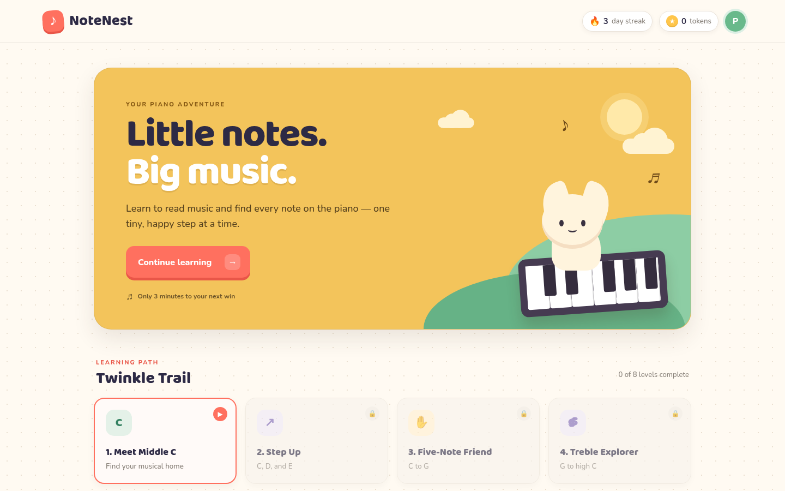

# NoteNest — Learn piano, one note at a time

A gentle, English-language piano-reading game for complete beginners. Read a note on the staff, find it on an on-screen piano, and walk an eight-level learning path with friendly feedback, tokens, and achievements.

**Live demo:** https://paulpowang.github.io/learning-piano-101/



## Features

- **Eight-level "Twinkle Trail"** — from *Meet Middle C* through C–G, treble G–high C, left-hand low C–G, note neighbors, a mini melody, and a final *Twinkle Star* level.
- **Interactive notation** — a treble staff shows each target note, with ledger lines where needed.
- **Playable piano** — tap or click the keys, or use the computer keyboard (`A S D F G H J K` = C4–C5).
- **Positive feedback** — gentle hints on wrong answers ("C is just left of two black keys"), 1–3 stars per level, and a results screen.
- **Tokens and achievements** — earn tokens for finishing levels and unlock six badges (First Sprout, Careful Ears, Trail Scout, Key Friend, Note Reader, Twinkle Hero).
- **Local progress saving** — progress lives in `localStorage` on this device. No account needed.
- **Responsive layout** — works on phones, tablets, and desktop.

> The "grown-up sign-in" dialog is a placeholder. Real Google Sign-In and cross-device sync would need an auth provider and a backend database. The app collects no account information.

## Tech stack

Plain static HTML, CSS, and vanilla JavaScript (`dist/index.html`, `dist/styles.css`, `dist/app.js`). There is no framework, build step, or backend. Fonts come from Google Fonts.

## Run locally

```bash
# Option 1: just open the file
open dist/index.html

# Option 2: serve the folder (any static server works)
npx serve dist
# or
python3 -m http.server 8000 -d dist
```

## Deploy

GitHub Pages deploys automatically through GitHub Actions (`.github/workflows/deploy-pages.yml`):

- Every push to `main` uploads the `dist/` folder as the Pages artifact.
- Pages source: **GitHub Actions** (`build_type: workflow`).
- All asset paths are relative, so the site works under `/learning-piano-101/` with no base-path config.

You can rerun the deploy from the **Actions** tab (`workflow_dispatch`).

---

## 中文簡介

NoteNest 是一款給鋼琴零基礎初學者的英文識譜小遊戲：看五線譜上的音符，在螢幕鋼琴上找出對應的琴鍵，沿著 8 個關卡逐步學會中央 C、右手五指、高音譜與左手音域。遊戲有溫和的提示、星星評分、代幣與成就徽章，進度只存在本機瀏覽器的 localStorage，不需要登入。

**線上試玩：** https://paulpowang.github.io/learning-piano-101/
